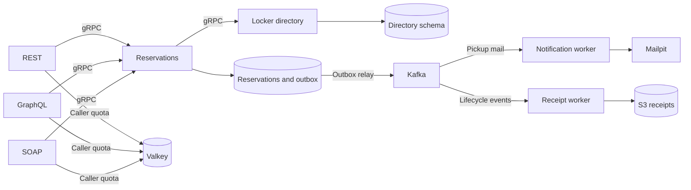

# Pickup locker microservices

A customer reserves a locker, a courier deposits a parcel, and the customer collects it with an emailed pickup code. REST, GraphQL and SOAP are three separately deployable applications. Each supports the entire journey. A reservation created through one protocol can be completed through either of the others.

## Start here

Start Docker, select the project’s Temurin 25 LTS with SDKMAN, and run the Compose verification from the repository root. You also need Bash, Python 3 and OpenSSL. The first run downloads dependencies and builds seven images.

```bash
sdk env install
sdk env
./scripts/compose-verify
```

This leaves the stack running. The JUnit suite reserves a compartment over REST, deposits over SOAP, reads the eight-digit code from Mailpit, collects over GraphQL, and restores the resulting audit receipts from a local backup. It also exercises all seven operations through each protocol. The suite selects an available small compartment at Central. It needs one free slot.

| Interface | Compose address | Contract |
| --- | --- | --- |
| REST | http://localhost:18081/v1 | [OpenAPI](locker-rest-api/src/main/resources/static/openapi.yaml) |
| GraphQL | http://localhost:18082/graphql | [GraphQL schema](locker-graphql-api/src/main/resources/graphql/locker.graphqls) |
| SOAP 1.1 | http://localhost:18083/soap/lockers | [WSDL](locker-soap-api/src/main/resources/wsdl/locker.wsdl), also served at `?wsdl` with a bearer token |
| Mailpit inbox | http://localhost:18025 | Inspect pickup messages by reservation ID |
| S3-compatible receipt store | http://localhost:19090 | The verification override exposes this loopback port |

To start only the application stack, run `./scripts/compose up -d`. To stop it and retain its data, run `./scripts/compose down`. The database, Kafka offsets and messages, inbox and receipt store have dedicated volumes. Keep `.lab/keys` with the installation. It holds the signing key, pickup secret and database passwords needed after a restart.

### Try the journey in a browser

From the repository root, run `sdk env` and `./scripts/manual-lab up`. This starts the locker services, browser helper, and local Grafana stack together. Open [Guided locker journey](http://localhost:18080). By default, the screen supplies ten-minute tokens for two fixed demo identities. The browser needs no keys or tokens.

1. As **Customer**, choose an available compartment and click **Reserve compartment**. The default protocol is REST. Copy the reservation ID or use the ID that the screen carries forward.
2. Switch to **Courier** and click **Deposit parcel** to call SOAP. To try an authorization failure, attempt the deposit as Customer first.
3. Open the [Mailpit inbox](http://localhost:18025). Find the message with your reservation ID in its subject. Switch back to **Customer**, enter the eight-digit code, and click **Collect parcel** to call GraphQL.
4. Expand a row in **Request history** to inspect its wire format, HTTP status, application response and duration. **Retry last command** repeats its original identity, protocol, input and request UUID. GraphQL can return an application error inside HTTP 200. The operation selector also supports lookup, cancellation before deposit, and code reissue. You can choose any protocol for any operation.

Click **View reservation logs** on the reservation card to open its events in [Grafana](http://localhost:13000/d/locker-overview/locker-overview). The dashboard also shows gateway request rate, errors and p95 duration by protocol. An increasing **outbox** count points to events awaiting publication in PostgreSQL. Increasing **Kafka consumer lag** points to published records still awaiting a worker's committed offset. Delivery counters distinguish successful sends or writes, identical receipt replays, retries and exhausted deliveries. Allow a few seconds for log shipping and metric scrapes. A latency percentile requires traffic in the selected time window.

**Follow a live request.** The **Live request flow** panel highlights calls on the LikeC4 diagram as OpenTelemetry spans arrive. Click **Open in new window** to watch alongside the guided journey. The window follows this journey automatically. Choose an earlier attempt in the request selector to pin it, or select **Inspect request flow** in request history. The timeline continues after the HTTP response, through Kafka publication, email delivery and receipt storage. A retry gets a separate trace even when it reuses the original command key.

**Inspect PostgreSQL.** The **Database inspector** refreshes every second by default while visible. Browse the four application tables, expand committed changes to see their before and after values, or select **All lab changes** to include other clients. The outbox can already be empty by the time you look. The change history keeps both the insert and delete for the configured retention window. Existing rows appear immediately. Change capture begins when the manual lab installs its triggers. The inspector connects using a role with read access to projected views.

The manual Compose overlay runs Tempo and starts the Java services with the OpenTelemetry agent. The reservations migration adds an optional trace parent to outbox entries for asynchronous delivery. The [LikeC4 model](deploy/manual/architecture/locker.c4) ships as a local SVG. After editing the model, regenerate it from the repository root with `node deploy/manual/architecture/render.mjs`.

Prometheus scrapes the seven application endpoints and the Kafka exporter. Alloy ships the application event files to Loki. Reservation, request and event IDs are searchable JSON fields. The domain events omit message bodies, pickup codes, email addresses and authentication headers. Grafana, the browser helper and Mailpit bind to the local loopback interface. The dashboard is available as a local viewer. The log store and metrics store retain three days of data by default.

```bash
./scripts/manual-lab verify   # Protocol checks and the two-window Chrome journey
./scripts/manual-lab down     # Stop the stack and keep its volumes
```

The browser test needs Google Chrome and network access on the first run for Selenium Manager to obtain the matching driver. Standard `./scripts/compose up -d` starts the smaller application stack. Both commands use the same local application data.

### Configure the lab

Set values in the shell for a single run, or put one `NAME=value` per line in `.env` at the repository root and run `./scripts/manual-lab up`. Shell values take precedence. Keep port or identity overrides in `.env` when you want later verification and token commands to reuse them. Re-run `up` after editing the file. The deployment keeps its PostgreSQL data.

```bash
LOCKER_PICKUP_TTL=30m LOCKER_PICKUP_MAX_ATTEMPTS=3 ./scripts/manual-lab up
```

Reservations snapshots the expiry and failure limit on deposit and reissue. Changing the deployment preserves both values and the failed-attempt count for an active code. A reissue uses the current policy, resets the counter and invalidates the previous code. The migration assigns existing codes their original five-attempt limit. In the browser, select **booking** in the database inspector to see `expires_at`, `attempts` and `pickup_max_attempts` for a deposited booking. At the expiry instant the code is already invalid.

| Setting | Default | Consumer and effect |
| --- | --- | --- |
| `LOCKER_PICKUP_TTL` | `15m` | Reservations, lifetime of a newly issued code. Positive Spring duration, such as `45s` or `30m`. |
| `LOCKER_PICKUP_MAX_ATTEMPTS` | `5` | Reservations, positive number of failed collections allowed per issued code. Replaying the same request ID counts once. |
| `LOCKER_RESERVATIONS_DEADLINE` / `LOCKER_DIRECTORY_DEADLINE` | `4s` / `2s` | gRPC deadlines per call, from each gateway to Reservations and from Reservations to Directory. |
| `RESERVATIONS_GRPC_PORT` / `DIRECTORY_GRPC_PORT` | `9090` each | Compose listener ports. Compose derives client targets from these values. |
| `LOCKER_RESERVATIONS` / `LOCKER_DIRECTORY` | `reservations:9090` / `directory:9090` | Override the gRPC targets with a host and port. |
| `LOCKER_OUTBOX_POLL_INTERVAL` | `300ms` | Reservations, delay after the previous relay run ends. Minimum 1 ms. |
| `LOCKER_OUTBOX_BATCH_SIZE` | `50` | Reservations, maximum pending events read in sequence per relay transaction. Positive integer. |
| `LOCKER_OUTBOX_ACK_TIMEOUT` | `12s` | Reservations, maximum wait for the Kafka send acknowledgement per event. The relay retains an unacknowledged row for retry. |
| `LOCKER_DELIVERY_RETRY_RETRIES` / `LOCKER_DELIVERY_RETRY_DELAY` | `3` / `500ms` | Both workers, short retries and their delay during a destination outage. With zero short retries, the first failure goes straight to the recovery interval. |
| `SPRING_KAFKA_BOOTSTRAP_SERVERS` | `kafka:9092` | Reservations and both workers, Kafka broker addresses. |
| `LOCKER_KAFKA_MAX_BLOCK_MS` / `LOCKER_KAFKA_DELIVERY_TIMEOUT_MS` / `LOCKER_KAFKA_REQUEST_TIMEOUT_MS` | `3000` / `10000` / `3000` | Reservations producer, maximum blocking time in `send`, delivery deadline and broker request timeout in milliseconds. |
| `DIRECTORY_DB_POOL_SIZE` / `RESERVATIONS_DB_POOL_SIZE` | `8` each | Compose maximum JDBC connections for each service. In Helm use `SPRING_DATASOURCE_HIKARI_MAXIMUM_POOL_SIZE` in the corresponding service. |
| `LOCKER_CORS_ORIGINS` | `http://localhost:18081,http://localhost:18082,http://localhost:18083` | All gateways, comma-separated browser origins. |
| `LOCKER_JWT_ISSUER` / `LOCKER_JWT_AUDIENCE` | `urn:locker:lab` / `locker-api` | Gateways, Reservations and demo signers. All participants must agree. |
| `LOCKER_RECEIPTS_BUCKET` / `AWS_REGION` | `locker-audit` / `us-east-1` | Receipt worker and host backup/restore client. Compose and Helm create the matching S3Mock bucket. Existing receipts stay in their original bucket. |
| `LOCKER_STORAGE` / `LOCKER_S3_ENDPOINT` | `http://objects:9090` / `http://127.0.0.1:19090` | Worker S3 endpoint inside the network and backup client endpoint on the host. |
| `LOCKER_MAIL_FROM` | `lockers@example.test` | Notification sender address. |
| `SPRING_MAIL_HOST` / `SPRING_MAIL_PORT` | `mailpit` / `1025` | Notification SMTP destination. |
| `SPRING_MAIL_PROPERTIES_MAIL_SMTP_TIMEOUT` / `SPRING_MAIL_PROPERTIES_MAIL_SMTP_CONNECTIONTIMEOUT` | `5000` each | Notification SMTP read and connect timeouts in milliseconds. |

For a Spring-only run the pickup properties are `locker.pickup.ttl` and `locker.pickup.max-attempts`. On Kubernetes, set environment entries in the chart's `apps.<service>.env` map. For example, add the following settings to the values file used for your Helm release. The gRPC listener setting there is `LOCKER_GRPC_PORT` for each service. The chart's stable service port is 9090.

```yaml
apps:
  reservations:
    env:
      LOCKER_PICKUP_TTL: "30m"
      LOCKER_PICKUP_MAX_ATTEMPTS: "3"
```

#### Browser and observability settings

| Setting | Default | Consumer and effect |
| --- | --- | --- |
| `LAB_REFRESH_MS` | `1000` | Milliseconds between visible live-flow and database refreshes. |
| `LAB_PAGE_SIZE` | `20` | Inspector rows per page for tables and changes. |
| `LAB_HISTORY_LIMIT` | `50` | Browser entries retained per journey and shown in request history. |
| `LAB_RETENTION_HOURS` | `72` | Browser flow history, database audit changes, Tempo, Loki and Prometheus. Minimum 24 hours for Loki. Database changes leave the visible window immediately and are pruned on the next captured write. |
| `LAB_BROWSER_TIMEOUT_MS` | `4000` | Browser timeout in milliseconds for inspector and diagram reads. |
| `LAB_INSPECT_TIMEOUT_SECONDS` / `LAB_GATEWAY_TIMEOUT_SECONDS` | `2` / `8` | Helper timeouts for PostgreSQL and Tempo reads, and for forwarding a gateway request. |
| `LAB_PORT` / `GRAFANA_PORT` / `MAILPIT_PORT` | `18080` / `13000` / `18025` | Published loopback ports for the browser lab, Grafana and Mailpit. |
| `LAB_GRAFANA_URL` / `LAB_MAILPIT_URL` | `http://localhost:13000` / `http://localhost:18025` | Override the browser links. By default each uses its configured published port. |
| `LAB_TOKEN_TTL_SECONDS` | `600` | Demo JWT lifetime in seconds for the browser helper and CLI. |

Open `/inspect/config` on the manual lab to see the effective browser settings. To use the same Compose configuration for a host-side command, prefix it with `./scripts/with-stack-env`, for example `./scripts/with-stack-env ./scripts/token.py customer alex`. Both Compose verification scripts do this automatically.

### Make a reservation

The token tool issues a ten-minute token for a synthetic customer or courier. The same bearer token works at all three gateways.

```bash
CUSTOMER=$(./scripts/with-stack-env ./scripts/token.py customer alex)
COURIER=$(./scripts/with-stack-env ./scripts/token.py courier driver)
curl -fsS -H "Authorization: Bearer $CUSTOMER" \
  'http://localhost:18081/v1/compartments?site=Central&size=LARGE'

REQUEST=$(python3 -c 'import uuid; print(uuid.uuid4())')
curl -i -H "Authorization: Bearer $CUSTOMER" -H "Idempotency-Key: $REQUEST" \
  -H 'Content-Type: application/json' -d '{"compartmentId":"CENTRAL-L1"}' \
  http://localhost:18081/v1/reservations
```

Copy the reservation `id` from the response. Send this GraphQL mutation to `/graphql` with the courier token, a fresh request UUID and that reservation ID. The pickup message arrives in Mailpit with the reservation ID in its subject.

```graphql
mutation Deposit($request: ID!, $id: ID!) {
  deposit(requestId: $request, id: $id) { id compartmentId state }
}
```

To finish over SOAP, post this envelope to `/soap/lockers` with the customer bearer token, `Content-Type: text/xml` and `SOAPAction: "urn:lockers:collect"`. Substitute another fresh request UUID, the reservation ID and the emailed code. Keep leading zeroes in the code.

```xml
<s:Envelope xmlns:s="http://schemas.xmlsoap.org/soap/envelope/" xmlns:l="urn:lockers:v1">
  <s:Body><l:collect>
    <l:requestId>REQUEST_UUID</l:requestId><l:id>RESERVATION_UUID</l:id><l:code>PICKUP_CODE</l:code>
  </l:collect></s:Body>
</s:Envelope>
```

| Operation | REST | GraphQL | SOAP |
| --- | --- | --- | --- |
| Find available compartments | `GET /v1/compartments` with optional `site`, `size` | `available` | `available` |
| Reserve | `POST /v1/reservations` | `reserve` | `reserve` |
| Read a reservation | `GET /v1/reservations/{id}` | `reservation` | `get` |
| Cancel before deposit | `POST /v1/reservations/{id}/cancel` | `cancel` | `cancel` |
| Deposit | `POST /v1/reservations/{id}/deposit` | `deposit` | `deposit` |
| Reissue a pickup code | `POST /v1/reservations/{id}/reissue` | `reissue` | `reissue` |
| Collect | `POST /v1/reservations/{id}/collect` | `collect` | `collect` |

Reads require `locker.read`. Customers use `locker.reserve` and a verified email to reserve. Only the owner can cancel, reissue or collect. Couriers use `locker.deposit` to deposit and can inspect reservations with read access. Each new command takes a UUID. Reuse that UUID and the same input when retrying the same command. The service returns its original result even across gateways. REST takes the UUID in `Idempotency-Key`. GraphQL and SOAP take `requestId`.

## Java quality checks

Run the complexity checks across all modules with the Maven wrapper.

```sh
./mvnw -Dtest=ComplexityTest,ComplexityLimitsTest test
```

The same JUnit checks run during `./mvnw clean verify`. They cover handwritten Java in production and tests, including the shared architecture tests. The limits are 7 for cyclomatic complexity, 15 for class fan-out, and 30 statements per method or 150 per type under JavaNCSS. The responsibility review links each declaration to its source and explains where independent requirements meet. [Shared Checkstyle rules](config/checkstyle/complexity.xml) · [Responsibility review](docs/responsibilities/README.md)

In IntelliJ IDEA, open a Java file and use **Code → Reformat Code** (⌥⌘L on macOS). The project scheme uses four spaces and a 120-column margin, and wraps long calls and declarations as needed. For complexity feedback in the editor, the optional CheckStyle-IDEA plugin uses the same rules and engine as Maven. [Project formatter](.idea/codeStyles/Project.xml) · [CheckStyle-IDEA configuration](.idea/checkstyle-idea.xml)

## Where the work happens



The directory owns sites, compartment sizes and IDs. Reservations owns occupancy and the state transitions. Each uses a separate PostgreSQL role and Liquibase schema. A partial unique index allows only one active reservation per compartment. A row lock serializes deposits, failed code attempts, collection and cancellation. Cancellation and collection make the compartment available again. The [protobuf contract](locker-contracts/src/main/proto/locker.proto) defines both internal services. By default, the gateway allows four seconds for Reservations, which allows two seconds for the Directory.

Spring Security checks signed JWTs at each public gateway. Reservations verifies the forwarded token on the internal gRPC call. The issuer is `urn:locker:lab` and the audience is `locker-api`. The cluster and Compose use private-network plaintext transport, local signing keys, Mailpit and an S3 emulator for this exercise.

### Following a reservation through the code

The REST controller, GraphQL resolver and SOAP endpoint call the same gateway port. A decorator times each call and records its outcome. At Reservations, the gRPC adapter binds the verified caller while a Spring method-security proxy checks the OAuth scope. The [security facade](reservation-service/src/main/java/study/locker/reservation/adapter/security/SecuredReservations.java) sets the read visibility for a customer or courier.

Follow a write through the [reservation wiring](reservation-service/src/main/java/study/locker/reservation/bootstrap/ReservationConfiguration.java). After the OAuth scope check, Reservations parses the request UUID. Spring enforces `@NotBlank` and `@Size(max = 100)` when the facade calls the `@Validated` submission bean. Then the observation decorator calls the transaction decorator. Inside the transaction, the replay handler locks the request key and either returns the original result or runs the [business handler](reservation-service/src/main/java/study/locker/reservation/application/ReservationCommands.java). The [Reservation aggregate](reservation-service/src/main/java/study/locker/reservation/domain/model/Reservation.java) owns the state transitions and pickup-code rules. A wrong code commits its attempt counter and journal entry before the endpoint returns an error. A rollback produces no committed-command log.

The Kafka message converter decodes JSON. Spring Kafka validates each typed `@Payload @Valid` argument before invoking the listener. Their decorators record delivery attempts and outcomes. The Kafka recovery callbacks record failures and dead-letter delivery.

Directory and Reservations map database rows to plain Java domain objects. Hibernate validates the tables that Liquibase creates. The [command journal row](reservation-service/src/main/java/study/locker/reservation/adapter/persistence/CommandRow.java) implements Spring Data’s `Persistable` because the caller supplies its composite key before insertion. A new entry is inserted directly. Persistence and load callbacks mark existing entries. Booking creation uses PostgreSQL’s atomic conflict handling to protect the last available compartment, and PostgreSQL generates the outbox sequence.

Run `./mvnw test` to check the [ArchUnit onion rules](locker-verification/src/architecture-test/java/study/architecture/OnionRules.java) against production classes and test classes in every module. Put domain tests alongside the domain package and adapter tests alongside their adapter. Service integration tests that wire several adapters together belong in the service’s `integration` test package.

### Asynchronous delivery

State changes and outbox rows commit together. The relay publishes with the reservation ID as the Kafka key and deletes rows after Kafka acknowledges them. A crash between acknowledgment and database commit can lead to redelivery.

| Kafka topic | Consumer group | Effect |
| --- | --- | --- |
| `locker.lifecycle.v1` | `locker-receipts-v1` | Conditionally creates `locker-audit/receipts/{reservationId}/{eventId}.json`. Identical replays succeed. A conflicting event ID leaves the original receipt intact. |
| `locker.pickup-mail.v1` | `locker-notifications-v1` | Decrypts a pickup code for delivery to the verified customer email. Expired messages are discarded. |

The default pickup policy expires a code after 15 minutes and locks it after five failed attempts. Reissue resets the counter and invalidates the old code. PostgreSQL stores a keyed verifier. The mail job carries an AES-GCM envelope. Public responses and audit receipts omit the code. SMTP delivery is at least once. A crash after SMTP accepts a message can cause a duplicate email with the same event identity.

Both workers validate decoded version-1 events before delivery. An invalid field sends the original record directly to the source topic plus `.dlt`. Validation diagnostics identify the fields. Malformed JSON, conflicting receipts and permanently rejected recipients go directly to the dead-letter topic. An unavailable destination pauses the listener with its offset pending. For a receipt conflict, compare the dead-letter event with the receipt at the event’s key before replay. For expired pickup mail, request a fresh code. Kafka and storage use one instance each in the local lab.

### Resilience and recovery

**Lost reply.** Each gateway charges the caller once per business operation. It can replay a read or a command carrying a valid request UUID once on a transient gRPC `UNAVAILABLE`, reusing the caller, UUID and payload. Both attempts and the jittered backoff share one deadline. Directory receives one attempt per incoming request. A committed reservation or a failed pickup attempt is recovered from the command journal on replay.

**Unavailable or busy dependency.** A semaphore limits concurrent outbound calls per service instance. A full semaphore rejects immediately. Each circuit breaker measures its own dependency over a count-based window. Directory-origin failures carry internal metadata so a Directory outage leaves reservation lookups available. The REST API returns 503 for dependency unavailability or saturation and 504 for an expired deadline. GraphQL exposes the gRPC code in `errors[].extensions.code`, and SOAP returns it in the fault detail.

**Caller quota.** All gateways and replicas use Bucket4j and Valkey to share one token bucket per authenticated issuer and subject. Each business field in a GraphQL query costs one token. On exhaustion, REST returns 429 and a `Retry-After` header in seconds. GraphQL and SOAP return `RESOURCE_EXHAUSTED`. The quota excludes health probes and internal retries. If Valkey times out, each gateway switches to a smaller local bucket until connectivity returns. During fallback the total allowance depends on the number of replicas. Quota buckets are ephemeral. Restarting Valkey or changing a shared budget starts a fresh bucket.

**Delivery outage.** S3 gets one SDK attempt per delivery and SMTP has bounded connect, read and write timeouts. Spring Kafka owns redelivery. After the short retries, the listener pauses between probes while Kafka retains its offset. Other partitions assigned to that listener can wait with it. The other worker runs independently. On recovery the receipt worker resumes conditional writes and the mail worker checks the code's expiry again. The outbox retains unacknowledged Kafka publications with their original event IDs.

| Environment setting | Lab default | Effect |
| --- | --- | --- |
| `LOCKER_GATEWAY_CAPACITY` / `LOCKER_DIRECTORY_CAPACITY` | 8 / 4 | Concurrent calls per gateway to Reservations and per Reservations instance to Directory. In Helm set `LOCKER_RPC_CAPACITY` on the caller. |
| `LOCKER_RPC_WINDOW` / `LOCKER_RPC_MINIMUM` / `LOCKER_RPC_THRESHOLD` | 20 / 10 / 50 | Window size, minimum measured calls, and failure percentage to open a breaker. |
| `LOCKER_RPC_OPEN` / `LOCKER_RPC_PROBES` | 10s / 2 | Open interval and number of half-open probes. |
| `LOCKER_RPC_RETRY` / `LOCKER_RPC_BACKOFF` | true / 100ms | Enable gateway replay and set its base delay. Jitter ranges from half to one and a half times this delay. |
| `LOCKER_QUOTA_URI` / `LOCKER_QUOTA_TIMEOUT` | redis://valkey:6379 / 100ms | Shared store address and check timeout. |
| `LOCKER_QUOTA_RATE` / `LOCKER_QUOTA_BURST` | 120 / 60 | Tokens replenished per minute and maximum accumulated tokens per caller. Set the same values on each gateway. |
| `LOCKER_QUOTA_LOCALRATE` / `LOCKER_QUOTA_LOCALBURST` / `LOCKER_QUOTA_CACHESIZE` | 20 / 10 / 10000 | Local fallback rate per minute, burst and maximum cached identities per gateway. |
| `LOCKER_DELIVERY_RETRY_PROBE` | 10s | Pause between destination recovery attempts after short retries are exhausted. |
| `LOCKER_RECEIPTS_TIMEOUT` / `SPRING_MAIL_PROPERTIES_MAIL_SMTP_WRITETIMEOUT` | 5s / 5000 ms | Total S3 API-call timeout and SMTP write timeout. |

#### Run the local outage drill

Start `./scripts/manual-lab up`, then run **`./scripts/manual-lab resilience-drill`** with one free compartment. The drill discards a reservation reply, replays the command, stops Directory, pauses S3 and pauses Valkey in turn. It checks that the booking remains readable, its cancellation receipt catches up, and quota enforcement recovers. It restores the affected containers on exit. In Grafana's Locker overview, the breaker states are 0 closed, 1 half-open and 2 open. Follow the gRPC rejections, worker delivery outcomes, consumer lag and quota fallback alongside the terminal output.

## Tests and operating exercises

```bash
./mvnw clean verify        # Surefire, Failsafe and disposable Testcontainers dependencies
./scripts/compose-verify   # Real public endpoints, mail delivery and S3 receipts
./scripts/install-tools    # Verified kind, kubectl and Helm binaries under .lab/bin
./scripts/kind-deploy      # Creates or updates the dedicated lockers-lab cluster
./scripts/kind-verify      # Starts temporary loopback forwards and runs the same public suite
./scripts/release-drill    # Exercises CPU scaling, failed readiness and a Helm rollback
```

The first kind deployment builds a Kubernetes v1.37.3 node image. Set `KIND_NODE_IMAGE` to use an available compatible image instead. The Helm chart installs into the `lockers` namespace. Internal gRPC services have cluster-local addresses. To inspect this deployment, use the scoped kubeconfig.

```bash
export PATH="$PWD/.lab/bin:$PATH" KUBECONFIG="$PWD/.lab/locker-kubeconfig"
kubectl -n lockers get deployments,pods,svc
helm -n lockers history lockers
```

For the rollout drill, the REST CPU target is 45% of its 100 millicore request, with two to four replicas. The script generates authenticated availability calls, records errors and sampled p95 latency, checks the ready EndpointSlices during a bad rollout, and restores the starting Helm revision. The traffic generator uses a port-forward to one REST pod. The readiness check also makes a request through the cluster Service. Results are written to the terminal and `.lab/drill-traffic.log`.

| Week | Exercise and evidence |
| --- | --- |
| 1 | Persist a reservation and race eight callers for one compartment. Follow the unique-index and idempotency assertions in [ReservationBookIT](reservation-service/src/test/java/study/locker/reservation/integration/ReservationBookIT.java). |
| 2 | Compare owner and courier permissions, JWT claims and an allowed and denied browser preflight in [LockerJourneyIT](locker-verification/src/test/java/study/locker/verification/LockerJourneyIT.java). |
| 3 | Follow one reservation across all three public contracts. Inspect gRPC caller propagation, an unavailable service and a stalled lookup in [GrpcBoundaryTest](locker-edge/src/test/java/study/locker/edge/integration/GrpcBoundaryTest.java). |
| 4 | Reproduce a broker outage and lost commit in the reservation suite. Verify duplicate events and dead-letter recovery with Kafka and S3 in [ReceiptDeliveryIT](receipt-worker/src/test/java/study/locker/receipt/integration/ReceiptDeliveryIT.java). |
| 5 | Back up receipts, repeat the restore, and detect a damaged copy in the cross-protocol journey. Use [ReceiptArchive](locker-verification/src/main/java/study/locker/verification/ReceiptArchive.java) on a completed reservation. |
| 6 | Inspect startup, readiness and liveness probes in the [Helm deployment](deploy/locker/templates/apps.yaml). Observe the unready replacement and check which pods receive traffic. |
| 7 | Run the release drill. Compare ready replica counts and p95 under load, then inspect the healthy revision after rollback. |
| 8 | Review the scoped occupancy lookup in [BookingRows](reservation-service/src/main/java/study/locker/reservation/adapter/persistence/BookingRows.java). Its PostgreSQL test compares indexed and sequential `EXPLAIN (ANALYZE, BUFFERS)` plans on the same 40,000 historical bookings and checks for identical results and fewer buffers. |

To make an offline archive of one completed reservation, use the S3 endpoint exposed by `compose-verify`. Wait until its final receipt is present. The destination directory must be new. These credentials are the fixed values accepted by the lab emulator.

```bash
export AWS_ACCESS_KEY_ID=lab AWS_SECRET_ACCESS_KEY=lab
./scripts/with-stack-env ./mvnw -pl locker-verification compile org.codehaus.mojo:exec-maven-plugin:3.5.0:java \
  -Dexec.mainClass=study.locker.verification.ReceiptArchive \
  "-Dexec.args=backup $RESERVATION_ID ./receipt-backup"
```

Replace `backup` with `restore` to restore the same reservation. Restore verifies the manifest against every local file before writing, preserves an identical existing receipt and reports a conflict if its content differs. The automated drill restores into an isolated prefix and removes its temporary objects.

Use a feature branch for changes and target `main` in pull requests. [GitHub Actions](.github/workflows/ci.yml) uses the Maven Wrapper in a pinned Temurin 25 image. It runs JUnit with Surefire and Failsafe, starts the Compose stack, runs the public acceptance suite, and uploads the XML reports.
